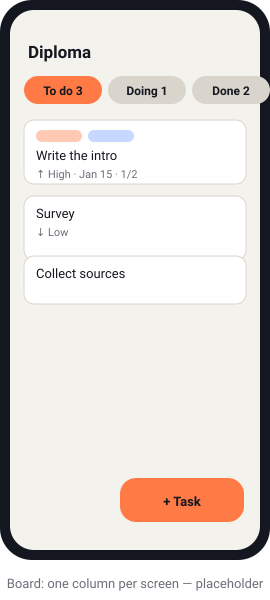
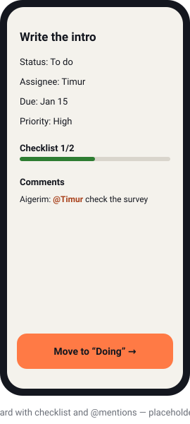
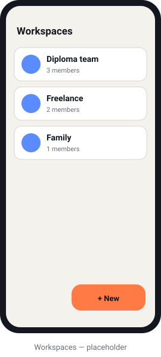
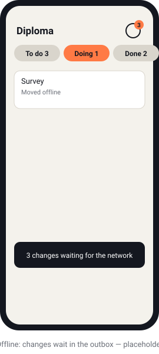

# FlowBoard

[](https://github.com/DoshiCkk/Kanban-system-flutter-/actions/workflows/api.yml)
[](https://github.com/DoshiCkk/Kanban-system-flutter-/actions/workflows/mobile.yml)

Mobile-first, offline-first Kanban for small teams — students, small IT teams, freelancers. Flutter (Android/iOS) + NestJS + PostgreSQL + Redis. Interface languages: Kazakh, Russian, English.

<p align="center">
  
  
  
  
</p>
<p align="center"><sub>Placeholders — replace the files in <code>docs/screenshots/</code> with emulator screenshots (same names, PNG or SVG).</sub></p>

## Features
- **Works offline.** Everything is stored on the device first; changes sync when the network is back. Two devices editing the same board converge (field-level last-writer-wins, delete wins) — [docs/sync.md](docs/sync.md).
- **Live.** A card moved on one phone shows up on the others in about a second (Socket.IO board rooms) — [docs/realtime.md](docs/realtime.md).
- **Made for one hand.** One column per screen with counted tabs, long-press drag with paging at the screen edge, "+ Task" quick add, a big "Move to the next column" button at the bottom of the card.
- **Team work.** Workspaces with roles and invite links, assignees, due dates, priorities, labels, checklists, comments with `@mentions`.
- **Push notifications** for assignments, mentions and "due tomorrow" — optional, the app and API run without Firebase — [docs/push.md](docs/push.md).
- **Templates:** Basic (To do / Doing / Done), Development (Backlog / To Do / In Progress / Review / Done), Empty.
- **Accessible:** WCAG AA contrast in light and dark themes, 48 dp tap targets, screen reader labels, cards movable without dragging, layouts tested at 200 % text size.

## Stack
| | |
|---|---|
| App | Flutter 3.44, flutter_bloc, go_router, get_it, Drift (SQLite), dio, socket_io_client, freezed, gen-l10n, Firebase Messaging (optional) |
| API | NestJS 12, TypeScript (strict, ESM), Prisma 7 + PostgreSQL 17, Redis 7 (Socket.IO adapter, rate limiting), Socket.IO, JWT access + rotating refresh tokens, argon2, Swagger, firebase-admin (optional) |
| Tests | flutter_test (unit, widget, accessibility guidelines), Vitest + supertest (unit, e2e on a real database) |
| CI | GitHub Actions: API checks, app checks + debug APK, manual unsigned iOS build |

## How it fits together
```
Flutter app                                         NestJS API
UI → Cubit → Repository → Drift (SQLite) ─┐         ┌─ REST /auth, /workspaces, /devices
                           Outbox ─► SyncEngine ──► │  /sync/push, /sync/pull ──► PostgreSQL
                     RealtimeClient ◄─ Socket.IO ── │  RealtimeGateway (board:<id>) ◄─► Redis
              NotificationService ◄─── FCM ──────── │  NotificationsService
```
The app reads only from its local database; the network is a background concern. Details: [docs/architecture.md](docs/architecture.md).

```
apps/mobile   Flutter app (feature-first: lib/features/<feature>/{data,domain,presentation}, lib/core)
apps/api      NestJS backend (one module per feature under src/)
docs/         architecture, sync, real-time, push, ADRs, backlog
.github/      CI workflows
```

## Requirements
- Windows 10/11 with PowerShell
- [Docker Desktop](https://www.docker.com/products/docker-desktop/)
- Node.js 24 LTS
- Flutter stable (3.44+) and Android Studio with an Android SDK and an emulator (AVD)

Check the toolchain:
```powershell
flutter doctor
node --version
docker --version
```

## 1. Start Postgres and Redis
```powershell
docker compose up -d
docker compose ps        # both services should be "healthy"
```
Defaults are in `.env.example`; copy it to `.env` to change ports or credentials. A second database, `flowboard_test`, is created for e2e tests.

## 2. Run the API
```powershell
cd apps/api
Copy-Item .env.example .env
# Put a real secret into JWT_ACCESS_SECRET:
node -e "console.log(require('crypto').randomBytes(48).toString('base64url'))"
npm install            # also generates the Prisma client
npm run db:deploy      # applies migrations to the dev database
npm run start:dev
```
- Health (checks Postgres and Redis): `Invoke-RestMethod http://localhost:3000/health`
- Swagger UI: http://localhost:3000/docs

Checks (e2e tests use the `flowboard_test` database and apply migrations themselves; Docker must be running):
```powershell
npm run lint; npm run format:check; npm run typecheck; npm test; npm run test:e2e
```
After changing `prisma/schema.prisma`: `npm run db:migrate -- --name <change>`.

### Try two users in one workspace (PowerShell)
```powershell
$api = 'http://localhost:3000'
$a = Invoke-RestMethod "$api/auth/register" -Method Post -ContentType 'application/json' -Body '{"email":"alice@example.com","password":"password123","name":"Alice"}'
$b = Invoke-RestMethod "$api/auth/register" -Method Post -ContentType 'application/json' -Body '{"email":"bob@example.com","password":"password123","name":"Bob"}'
$ha = @{ Authorization = "Bearer $($a.tokens.accessToken)" }
$hb = @{ Authorization = "Bearer $($b.tokens.accessToken)" }
$ws = Invoke-RestMethod "$api/workspaces" -Method Post -Headers $ha -ContentType 'application/json' -Body '{"name":"Team"}'
$inv = Invoke-RestMethod "$api/workspaces/$($ws.id)/invites" -Method Post -Headers $ha
Invoke-RestMethod "$api/invites/$($inv.token)/accept" -Method Post -Headers $hb
Invoke-RestMethod "$api/workspaces/$($ws.id)/members" -Headers $ha | ConvertTo-Json -Depth 4
```

## 3. Run the mobile app
Start an Android emulator (Android Studio → Device Manager, or `flutter emulators --launch <id>`), then:
```powershell
cd apps/mobile
flutter pub get
flutter run --dart-define-from-file=config/dev.json
```
`config/dev.json` points the app at `http://10.0.2.2:3000` — the emulator's alias for your PC.
Override for other targets, e.g. a physical device on the same Wi-Fi:
```powershell
flutter run --dart-define=API_BASE_URL=http://192.168.1.10:3000
```

Invite links have the form `flowboard://app/invite/<token>`. To open one on the emulator:
```powershell
adb shell am start -a android.intent.action.VIEW -d "flowboard://app/invite/<token>"
```

Checks (`test/accessibility_test.dart` also runs Flutter's tap target, label and contrast guidelines in both themes):
```powershell
flutter gen-l10n; dart format --set-exit-if-changed lib test tool; flutter analyze; flutter test
```
After changing `@freezed` / `@JsonSerializable` models regenerate code:
```powershell
dart run build_runner build --delete-conflicting-outputs
```
(If `dart` on your PATH is not Flutter's own, call it explicitly, e.g. `& "$((Get-Command flutter).Source | Split-Path)\dart.bat" run build_runner build`.)

## Offline sync: manual check
Design: [docs/sync.md](docs/sync.md). The cloud icon in the board's app bar shows the state (synced / syncing / `n` changes waiting / error); tap it to sync now.
1. Turn on airplane mode on the emulator.
2. Create a board, add a few cards and move two of them. The icon shows the number of queued changes.
3. Kill the app (swipe it away), start it again: everything is still there.
4. Turn the network back on: within a couple of seconds the icon turns into a check mark.
5. Sign in as a second user of the same workspace (another emulator, or `flutter run -d <device>` on a second device) and open the board: it has the same columns and cards.

Inspect what the server has (PowerShell, after logging in as in the snippet above):
```powershell
Invoke-RestMethod "$api/sync/pull?workspaceId=$($ws.id)&since=0" -Headers $ha | ConvertTo-Json -Depth 5
```

## Real-time and comments: check
Design: [docs/realtime.md](docs/realtime.md). Start two emulators (Android Studio → Device Manager) and run the app on each, in two terminals:
```powershell
flutter devices   # note both emulator ids
flutter run -d emulator-5554 --dart-define-from-file=config/dev.json
flutter run -d emulator-5556 --dart-define-from-file=config/dev.json
```
1. Sign in as two users of one workspace (see "Try two users in one workspace").
2. Open the same board on both and move a card on one: it moves on the other in about a second.
3. Open a card, type `@` in the comment field, pick the teammate and send: the comment appears on the other device with the name highlighted.

Without emulators, the same round trip runs as a test against the local API — two in-memory "devices" with the real sync and Socket.IO clients. With the API running (section 2):
```powershell
cd apps/mobile
$env:FLOWBOARD_LIVE_API = 'http://localhost:3000'
flutter test test/live
Remove-Item Env:FLOWBOARD_LIVE_API
```
It prints the measured latency: about 540 ms, 500 ms of which is the deliberate push debounce.

## Push notifications
Off by default — the API and the app work without a Firebase project. To turn them on (Firebase project, `google-services.json`, service account key, `--dart-define=PUSH_ENABLED=true`) follow [docs/push.md](docs/push.md).

## iOS
iOS cannot be built on Windows. The code avoids Android-only APIs, and the iOS project targets iOS 15 (the Firebase SDK minimum). To check that it builds, run the **iOS build** workflow by hand on GitHub (Actions → iOS build → Run workflow): an unsigned release build on a macOS runner. On the iOS simulator use `API_BASE_URL=http://localhost:3000`.

## Continuous integration
| Workflow | When | What |
|---|---|---|
| [API](.github/workflows/api.yml) | changes in `apps/api` | lint, format, typecheck, unit tests, e2e tests against Postgres and Redis containers |
| [Mobile](.github/workflows/mobile.yml) | changes in `apps/mobile` | format, analyze, tests, generated code is current; debug APK build (downloadable artifact) |
| [iOS build](.github/workflows/ios.yml) | by hand | unsigned `flutter build ios` on macOS |

## Documentation
- [docs/architecture.md](docs/architecture.md) — layers and phases
- [docs/sync.md](docs/sync.md) — offline sync protocol and conflict rules
- [docs/realtime.md](docs/realtime.md) — Socket.IO rooms, comments and mentions
- [docs/push.md](docs/push.md) — push notifications and Firebase setup, step by step
- [docs/adr/](docs/adr/) — decisions; [docs/backlog.md](docs/backlog.md) — what is deferred
- `apps/mobile/tool/generate_branding.dart` — draws the app icon and splash (then `dart run flutter_launcher_icons`, `dart run flutter_native_splash:create`)

## Troubleshooting
- **`flutter pub get` fails with a symlink error** — enable Windows Developer Mode: `start ms-settings:developers`.
- **Emulator cannot reach the API** — the API listens on `0.0.0.0:3000`; allow Node.js through Windows Firewall for private networks.
